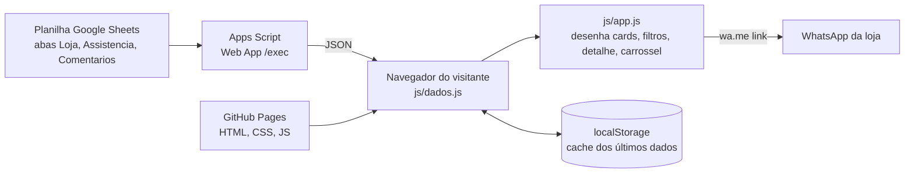

# Z-Tech Informática | Web Catálogo

Catálogo online da **Z-Tech Informática**, loja e assistência técnica de computadores e impressoras, com venda de câmeras e afins, peças e computadores montados.

O site é estático (HTML, CSS e JavaScript puro, sem frameworks). **Quem edita o conteúdo é uma planilha do Google Sheets**: cada linha nova vira um item na página, sem mexer no código. O cliente escolhe o item e fala com a loja pelo **WhatsApp**.

- **Site publicado:** https://marcos-vinicius-mm.github.io/Z-Tech_web_catalogo/
- **Hospedagem:** GitHub Pages (branch `main`)
- **Banco de dados e painel de administração:** Google Sheets + Google Apps Script

---

## Sumário

1. [O que o sistema faz](#1-o-que-o-sistema-faz)
2. [Como funciona (arquitetura)](#2-como-funciona-arquitetura)
3. [Estrutura do repositório](#3-estrutura-do-repositório)
4. [A planilha](#4-a-planilha)
5. [Apps Script (a "API")](#5-apps-script-a-api)
6. [Configuração do site](#6-configuração-do-site)
7. [Páginas e comportamento](#7-páginas-e-comportamento)
8. [Regras de dados](#8-regras-de-dados)
9. [Identidade visual e interface](#9-identidade-visual-e-interface)
10. [Acessibilidade, desempenho e SEO](#10-acessibilidade-desempenho-e-seo)
11. [Rotina de uso (dia a dia)](#11-rotina-de-uso-dia-a-dia)
12. [Fluxo de desenvolvimento](#12-fluxo-de-desenvolvimento)
13. [Problemas comuns](#13-problemas-comuns)
14. [Limitações conhecidas e pendências](#14-limitações-conhecidas-e-pendências)
15. [Licenças](#15-licenças)

---

## 1. O que o sistema faz

| Área | O que o visitante vê |
|---|---|
| **Início** | Logo, botão de WhatsApp, atalhos para Loja e Assistência, carrossel com comentários de clientes, endereço, horário e link "Como chegar" (Google Maps). |
| **Loja** | Grade de produtos e peças, com busca, filtro por tipo e categoria, ordenação por preço e janela de detalhes do item. |
| **Assistência técnica** | Grade de serviços e consertos, com prazo e garantia, busca, filtro por categoria, ordenação e janela de detalhes. |

Decisões de projeto:

- **Não há pagamento, carrinho nem login.** O contato é sempre por WhatsApp, com mensagem já preenchida com o nome do item.
- Todo trabalho é feito em **branches separadas** e entra na `main` por Pull Request.
- A planilha é a única fonte de conteúdo; o código não guarda produtos.

---

## 2. Como funciona (arquitetura)



1. O dono da loja edita a planilha.
2. O Apps Script publicado como Web App devolve as abas em **JSON**.
3. O navegador chama essa URL (`fetch`), valida e normaliza os dados (`js/dados.js`) e desenha a página (`js/app.js`).
4. Os últimos dados válidos ficam em `localStorage`; se a planilha estiver fora do ar ou demorar, o site mostra o cache com um aviso.
5. O botão de WhatsApp abre `https://wa.me/<número>?text=<mensagem>` com o nome do item.

A leitura por Apps Script foi escolhida no lugar de "planilha publicada como CSV" por causa de relatos inconsistentes de CORS. Sincronizar a planilha com o repositório por GitHub Action também foi descartado (só atualizaria a cada execução).

---

## 3. Estrutura do repositório

```
Z-Tech_web_catalogo/
├── index.html            Página inicial
├── loja.html             Lista de produtos e peças
├── assistencia.html      Lista de serviços
├── css/
│   └── styles.css        Todo o visual (tokens, componentes, responsivo)
├── js/
│   ├── config.js         Única fonte de configuração do site
│   ├── dados.js          Leitura, validação e cache dos dados
│   └── app.js            Renderização: cards, filtros, detalhe, carrossel, rodapé
├── apps-script/
│   └── Code.gs           Código colado no Apps Script da planilha
├── img/
│   ├── logo.jpg          Logo completa (hero e prévia de compartilhamento)
│   ├── marca.png         Marca circular (favicon, cabeçalho e imagem padrão dos cards)
│   └── whatsapp.svg      Ícone do WhatsApp usado no botão do detalhe (arquivo da loja)
├── fonts/
│   ├── inter.woff2       Fonte Inter (variável), hospedada no próprio site
│   └── LICENSE-Inter.txt Licença da fonte (OFL)
├── docs/
│   └── ESPECIFICACAO.md  Especificação funcional do projeto
└── README.md
```

---

## 4. A planilha

Três abas, com **estes nomes exatos**: `Loja`, `Assistencia` (sem acento) e `Comentarios` (sem acento). A **primeira linha de cada aba é o cabeçalho** e os nomes das colunas devem ser escritos em minúsculas, como abaixo.

### Aba `Loja`

| Coluna | Obrigatória | Descrição |
|---|:---:|---|
| `id` | sim | Gerado automaticamente (`L001`, `L002`...) |
| `nome` | sim | Nome exibido |
| `tipo` | | `produto` ou `peca` (usado no filtro "Tipo") |
| `categoria` | | Ex.: Notebooks, Memórias, Periféricos. Vazio vira "Outros" |
| `marca` | | Marca do item |
| `descricao` | | Texto curto |
| `preco` | | Formato brasileiro (ver [regras](#8-regras-de-dados)) |
| `estoque` | | Quantidade ou disponibilidade |
| `condicao` | | `novo` ou `usado` |
| `compatibilidade` | | Opcional, útil para peças |
| `imagem` | | URL pública ou link de arquivo do Google Drive |
| `destaque` | | `SIM` faz o item aparecer primeiro na ordenação padrão |
| `ativo` | sim | `SIM` exibe; vazio ou `NAO` oculta |

### Aba `Assistencia`

| Coluna | Obrigatória | Descrição |
|---|:---:|---|
| `id` | sim | Gerado automaticamente (`A001`...) |
| `nome` | sim | Nome do serviço |
| `categoria` | | Ex.: Formatação, Troca de tela, Limpeza |
| `descricao` | | Texto curto |
| `preco` | | Valor, "a partir de" ou "sob orçamento" |
| `prazo` | | Prazo estimado |
| `garantia` | | Garantia oferecida |
| `equipamentos` | | Equipamentos atendidos |
| `imagem` | | URL pública ou link do Drive |
| `ativo` | sim | `SIM` exibe; vazio ou `NAO` oculta |

### Aba `Comentarios`

Alimenta o carrossel da página inicial.

| Coluna | Obrigatória | Descrição |
|---|:---:|---|
| `id` | sim | Gerado automaticamente (`C001`...) |
| `nome` | sim | Nome exibido (de preferência primeiro nome e inicial do sobrenome) |
| `comentario` | sim | Texto do cliente (até cerca de 300 caracteres) |
| `nota` | | Número de 1 a 5 (vira estrelas). Fora disso é ignorada |
| `servico` | | `Loja` ou `Assistência técnica` |
| `data` | | `dd/mm/aaaa` (ou `aaaa-mm-dd`). Os mais recentes aparecem primeiro |
| `ativo` | sim | `SIM` publica; vazio ou `NAO` oculta |

> Só publique comentário com autorização do cliente.

### ID automático

Ao preencher a coluna `nome` de uma linha sem `id`, o Apps Script gera o próximo número da sequência da aba (`L`, `A` ou `C` + três dígitos). Para importações em massa ou colagens que não disparam o gatilho, rode manualmente a função `preencherIds` no editor do Apps Script.

---

## 5. Apps Script (a "API")

O arquivo `apps-script/Code.gs` contém:

- `doGet()`: devolve `{ loja, assistencia, comentarios }` em JSON. Lê os valores **como exibidos** (`getDisplayValues`), então o preço `1.299,90` chega intacto. Os **comentários** só saem com `ativo = SIM` (filtrados no servidor).
- `onEdit(e)`: gatilho simples que preenche o `id` quando a coluna `nome` é editada.
- `preencherIds()` e `preencherAba()`: geram os ids pendentes, com trava (`LockService`) para evitar duplicidade.

### Publicar (uma vez)

1. Na planilha: **Extensões → Apps Script** e cole o conteúdo de `Code.gs`.
2. **Implantar → Nova implantação → Tipo: App da Web.**
3. *Executar como:* você. *Quem tem acesso:* **Qualquer pessoa**.
4. Copie a URL que termina em `/exec` e cole em `API_URL` no `js/config.js`.

> Se alterar o `Code.gs`, é preciso **criar uma nova versão da implantação** (Implantar → Gerenciar implantações → editar → Nova versão) para a mudança valer na URL `/exec`.

---

## 6. Configuração do site

Tudo fica em `js/config.js` (único arquivo que você edita para mudar dados da loja):

| Chave | Para que serve |
|---|---|
| `NOME` | Nome da loja |
| `WHATSAPP` | Só dígitos, com `55` + DDD + número (ex.: `5588...`) |
| `API_URL` | URL do Web App (`.../exec`). **Vazio = modo demonstração**, com itens de exemplo |
| `ENDERECO` | Endereço exibido no rodapé |
| `HORARIO` | Horário de atendimento exibido no rodapé |
| `MAPS_URL` | Link do Google Maps da loja. Vazio = o site monta uma busca pelo `ENDERECO` |
| `TIMEOUT_MS` | Tempo máximo de espera pela planilha (padrão 15000 ms; a primeira chamada do Apps Script pode demorar) |

---

## 7. Páginas e comportamento

### Menu superior

Preto, compacto, com filete vermelho e itens separados por barra vertical (`Início | Loja | Assistência técnica`). No celular o texto vira "Assistência"; no desktop (a partir de 48 rem) o cabeçalho fica fixo no topo e o item atual aparece em vermelho.

### Início (`index.html`)

- Hero com a logo sobre fundo preto e o botão **Falar no WhatsApp** (mensagem: "Olá! Vim pelo site da Z-Tech Informática.").
- Dois atalhos grandes: Loja e Assistência técnica.
- **Carrossel de comentários** (some se não houver comentários ou se a leitura falhar):
  - 1 comentário por tela no celular e 3 no desktop;
  - setas, pontos de navegação, rolagem por toque e setas do teclado;
  - **rotação automática a cada 6 segundos**, sem botão de pausa;
  - para sozinho enquanto o mouse está sobre ele, quando há foco por teclado, ou com a aba em segundo plano, e volta depois; depois de qualquer clique nas setas ou pontos, a próxima troca espera 6 segundos inteiros;
  - desligado se o aparelho pedir "reduzir movimento" (`prefers-reduced-motion`).
- Rodapé com endereço, horário e **Como chegar**.

### Loja (`loja.html`)

- **Busca** por nome, marca, descrição e categoria.
- **Filtros:** Tipo (produto ou peça), Categoria (montada com as categorias existentes).
- **Ordenar:** padrão (destaques primeiro, depois ordem alfabética), menor preço e maior preço. Itens sem preço numérico ficam por último.
- Contador de itens e atalho **Limpar filtros**.
- **Cards:** 2 por linha no celular e grade automática (cards de pelo menos 15 rem) a partir de 40 rem. Cada card mostra imagem, categoria, nome (até 3 linhas) e **preço fixo no canto inferior esquerdo**.
- **Imagens padronizadas:** moldura única de proporção 4:3; a foto aparece inteira dentro dela (`object-fit: contain`, fundo branco), sem cortar nem vazar. Sem foto, aparece a marca Z-Tech sobre fundo preto; se a foto falhar ao carregar, aparece "Foto indisponível".
- **Detalhe (janela modal):** foto, nome, preço, descrição e ficha (marca, condição, estoque, compatibilidade). Botões **Fechar** e **Chamar no WhatsApp** lado a lado, com o ícone `img/whatsapp.svg`. A mensagem enviada é "Olá! Tenho interesse neste item: *nome*".

### Assistência técnica (`assistencia.html`)

Igual à Loja, mas sem o filtro "Tipo". O card mostra "Prazo | Garantia", e o botão do detalhe é **Pedir orçamento** (mensagem: "Olá! Gostaria de um orçamento para: *nome*"). A ficha mostra prazo, garantia e equipamentos atendidos.

### Estados da lista

Carregando (com aviso extra se passar de 4 s), lista vazia, erro com **motivo explícito** e botão "Tentar novamente", e avisos de "dados de demonstração" ou "mostrando os últimos dados salvos".

---

## 8. Regras de dados

- **Linhas sem `id`, sem `nome` ou sem `ativo = SIM` são ignoradas.**
- **Preço** (formato brasileiro, nunca "adivinhado"):

  | Entrada | Resultado |
  |---|---|
  | `1.299,90`, `1299,90`, `49`, `R$ 49,90` | R$ 1.299,90 / R$ 1.299,90 / R$ 49,00 / R$ 49,90 |
  | `a partir de 80,00` | A partir de R$ 80,00 |
  | `sob orçamento` | Sob orçamento |
  | vazio ou formato inválido | "Consulte o valor" (o inválido gera aviso no console) |

  Isso evita o bug de preços dez vezes maiores por vírgula e ponto trocados.
- **Imagem:** aceita URL pública `http(s)` (`http` vira `https`) ou **link de compartilhamento do Google Drive**, convertido pelo código do arquivo em uma miniatura. O arquivo precisa estar como **"Qualquer pessoa com o link"**. Link de **pasta** do Drive é ignorado, e texto que não seja URL também.
- **Comentário:** exige `id`, `nome`, `comentario` e `ativo = SIM`; nota fora de 1 a 5 é descartada (e registrada no console).
- **Cache:** os últimos dados lidos com sucesso ficam em `localStorage` (chave `ztech:dados:v1`).
- **Rede:** 2 tentativas de leitura, com tempo limite de `TIMEOUT_MS`. Erro de configuração (resposta que não é JSON, HTTP 4xx) não é repetido.

---

## 9. Identidade visual e interface

- **Paleta (tirada da logo):** preto `#000`, branco `#FFF`, vermelho `#C22127` (vermelho escuro `#9A1A1F` para hover e textos sobre fundo claro) e verde `#15803D` (hover `#116B32`) nos botões.
- **Tipografia:** família única **Inter** (variável, hospedada em `fonts/inter.woff2`), pesos 400 a 800 e escala de tamanhos definida como variáveis CSS (`--t-xs` a `--t-3xl`). Sem fontes externas.
- **Componentes:** cabeçalho preto com filete vermelho, cards brancos com borda superior vermelha, filtros em "cartão" com campos arredondados, rodapé escuro compacto.
- **Mobile-first:** a página foi pensada para celular e cresce para tablet e desktop.
- **Cache dos arquivos:** os HTML apontam para `css/styles.css?v=N`, `js/*.js?v=N`. Ao mudar CSS ou JS, **aumente o número `?v=` nos três HTML** para o navegador baixar a versão nova (o GitHub Pages deixa os arquivos em cache por cerca de 10 minutos).

---

## 10. Acessibilidade, desempenho e SEO

- Contraste verificado (branco sobre `#15803D` tem 5,02:1), foco visível em todos os controles, textos alternativos nas imagens, semântica HTML (`header`, `nav`, `main`, `footer`, `dialog`).
- Carrossel com `role="region"`, rótulos "n de total", navegação por teclado e `aria-live` coerente com a rotação automática.
- Janela de detalhe usa `<dialog>` nativo (Esc fecha, foco preso na janela).
- Animações respeitam `prefers-reduced-motion`.
- Sem dependências de runtime: nenhuma biblioteca, CDN ou fonte externa. A fonte é pré-carregada (`preload`).
- SEO básico: `title`, `description`, Open Graph (`og:title`, `og:description`, `og:image`) e `theme-color` em todas as páginas.

---

## 11. Rotina de uso (dia a dia)

**Cadastrar ou editar item:** abra a planilha, preencha uma nova linha (o `id` aparece sozinho ao digitar o `nome`), marque `ativo = SIM` e pronto. O site mostra a mudança no próximo carregamento.

**Esconder um item:** troque `ativo` para `NAO` (ou apague o `SIM`).

**Colocar em destaque:** `destaque = SIM`.

**Publicar um comentário:** preencha a linha na aba `Comentarios` e marque `ativo = SIM` somente depois da autorização do cliente.

**Trocar telefone, endereço, horário ou link do mapa:** edite `js/config.js` (via branch e Pull Request).

**Rodar localmente:** o site é estático. Abra a pasta com qualquer servidor simples (por exemplo `python3 -m http.server 8000` e acesse `http://localhost:8000`). Sem `API_URL` ele roda em modo demonstração.

---

## 12. Fluxo de desenvolvimento

1. Atualize a `main` (`git checkout main && git pull`).
2. Crie uma branch para a alteração (`git checkout -b feat/nome-da-mudanca`).
3. Edite, teste no navegador (celular e desktop) e, se mexer em CSS ou JS, aumente o `?v=` dos HTML.
4. `git add`, `git commit`, `git push -u origin feat/nome-da-mudanca`.
5. Abra um **Pull Request** para a `main`. Ao fazer o merge, o GitHub Pages publica sozinho em poucos minutos.
6. Recarregue o site com `Ctrl + Shift + R` para ignorar cache.

Histórico resumido das entregas: especificação e estrutura base → integração com a planilha (Apps Script, id automático) → imagens por URL pública ou Drive → identidade visual da logo → menu compacto e responsivo, lista em grade → fonte Inter, aba de comentários e carrossel → ajustes de interface (carrossel automático, rodapé menor, botões do detalhe, preço fixo nos cards, imagens padronizadas).

---

## 13. Problemas comuns

| Sintoma | Causa provável | O que fazer |
|---|---|---|
| "Não foi possível carregar a lista" + motivo | Planilha inacessível ou implantação errada | Leia o **motivo** na mensagem. "devolveu uma página em vez de JSON": a implantação precisa estar com acesso **Qualquer pessoa** e a URL terminar em `/exec` |
| "Tempo esgotado" | Apps Script lento na primeira chamada | Tente novamente; o site já refaz uma tentativa sozinho |
| Lista abre em um aparelho e não em outro | Rede bloqueando `script.google.com` ou acesso da implantação | Teste a URL `/exec` no aparelho e confira o acesso "Qualquer pessoa" |
| "Dados de demonstração" | `API_URL` vazio no `config.js` | Cole a URL do Web App |
| "Mostrando os últimos dados salvos" | Sem conexão com a planilha | Verifique a internet ou a implantação; os dados são os do último acesso bem-sucedido |
| Foto não aparece ("Foto indisponível") | Arquivo do Drive não compartilhado ou link quebrado | Compartilhe como "Qualquer pessoa com o link" e use o link do **arquivo** (não da pasta). Abra o console do navegador para ver qual item falhou |
| Preço aparece como "Consulte o valor" | Formato inválido ou campo vazio | Use `1.299,90`, `a partir de 80,00` ou `sob orçamento`; o console mostra o valor rejeitado |
| Mudei o CSS/JS e o site continua igual | Cache do navegador | Aumente `?v=` nos HTML e recarregue com `Ctrl + Shift + R` |
| Mudei o `Code.gs` e nada mudou | Implantação antiga | Crie uma **nova versão** da implantação |
| Item novo não ganhou `id` | Colagem ou importação em massa não dispara o gatilho | Rode `preencherIds` no editor do Apps Script |

---

## 14. Limitações conhecidas e pendências

- **As abas `Loja` e `Assistencia` são entregues inteiras no JSON público** (o filtro `ativo = SIM` dessas duas abas é feito no navegador). Não coloque nelas dados que não possam ficar públicos, como custo ou observações internas. Só os comentários são filtrados no servidor.
- O site depende do Apps Script (limites de cota do Google se aplicam) e do cache do `localStorage` para ficar de pé quando a planilha falha.
- Não há painel administrativo próprio; a planilha cumpre esse papel.
- Fora do escopo desta versão: carrinho, pagamento e login.
- Pendências: links das redes sociais da loja; comentários reais de clientes (com autorização).

---

## 15. Licenças

- **Inter** (fonte): SIL Open Font License 1.1, texto em `fonts/LICENSE-Inter.txt`.
- O logotipo da Z-Tech Informática pertence à loja. O ícone do WhatsApp (`img/whatsapp.svg`) é marca do WhatsApp e foi fornecido pelo dono do projeto.
